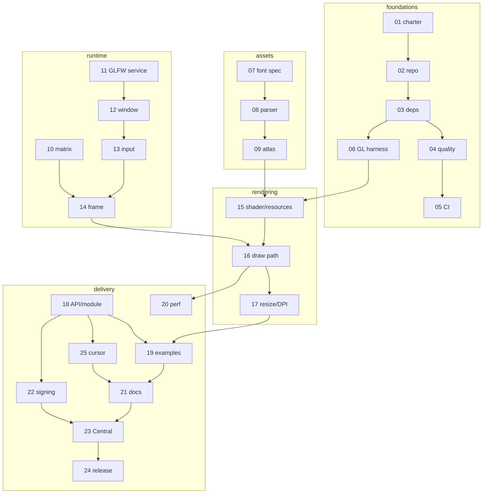

# terminal-window 2.0 — sectioned build guide

Guide only. No implementation code lives in these files; each section is sized for one planning pass.

- Artifact: `com.psiwray.organization:terminal-window` (v1 exists up to `1.4.1`, 2021-10-24; v1 cannot be deleted from Central).
- v2 release: `2.0.0`.
- Repository: `psiwray-corp/terminal-window` on GitHub (currently 404 from the public API; create or open it in section 02).

## How to use

1. Read this file only.
2. Read exactly one `docs/guide/NN-*.md`. Do not read sibling sections; cross-section constraints are in the facts/invariants below.
3. Plan and implement that section.
4. Update the checklist here and leave all changes uncommitted for the user.
5. A section is done only when every `## Acceptance` box is demonstrated, not inferred.

## Fixed facts (do not re-derive)

| Fact | Value | Why |
|---|---|---|
| Group / artifact | `com.psiwray.organization` / `terminal-window` | Same coordinates as v1; versions are immutable, v2 adds `2.0.0` |
| Language | **Kotlin 2.4.21**, JVM target 25 | Stable release (2.5 is RC); Gradle 9.9.1 embeds 2.4.21 |
| JDK | **25** toolchain | Current LTS; Gradle 9.9.1 supports running on 25 |
| Gradle | 9.9.1 wrapper, Kotlin DSL, version catalog | Current stable (2026-11) |
| Build system | **Gradle only**; no `pom.xml` | Maven Central is the repository; Maven snippets are consumer-only |
| CI | **GitHub Actions** | Shared `ci/*.sh`; the contributor gate needs no self-hosted runner |
| LWJGL | 3.4.3 (`lwjgl`, `lwjgl-glfw`, `lwjgl-opengl`, `lwjgl-stb` runtime) | Current stable, verified on Maven Central; STB decodes icon/cursor images |
| Math | **JOML 1.10.9** (`org.joml:joml`, `api`) | Included per request; 2-D vectors available; core renderer still emits clip-space quads without matrices |
| OpenGL floor | **3.3 core**, GLSL `#version 330` | 3.0 lacks core `glVertexAttribDivisor` (3.3) and would force `ARB_instanced_arrays`; macOS caps at 4.1 core |
| Module name | automatic `com.psiwray.organization.terminal_window` | Kotlin does not emit `module-info`; set `Automatic-Module-Name` in the manifest (section 18) |
| Packages | `com.psiwray.organization.terminal_window[.font|.input|.internal]` | Same root as v1; v1 and v2 must not share a classpath |
| Font format | `.twf`, UTF-8 text, `version 1` | Strict, line-numbered errors; pixels are `.`/`#` |
| Draw cost | 1 draw call per window per rendered frame, instanced, 16 B/cell | `gl_VertexID` quad, no vertex/index buffer |
| Atlas | 1 × `GL_R8` texture, 1 B/px, `GL_NEAREST` | Memory-minimal; the shader reads `.r` as the mask |
| Update cadence | demand-driven: at most 1 instance upload and 1 draw call per window per rendered frame; `TerminalMatrix` dirty bit, resize, or `TerminalWindow.requestRepaint()` triggers a frame, `TerminalWindow.forceRepaint` overrides and repaints every frame opportunity | Mutations coalesce; one-shot repaint requests coalesce with resize snapshots; never one GL call per cell; an unchanged, unforced, unrequested window does no instance pack, upload, draw, or swap |
| Event routing | process main thread polls once per process and routes by GLFW handle to one bounded queue per window | owner threads drain only their own queue; no cross-window blocking |
| Build profiles | Gradle property `terminalWindow.profile` = `debug` (local default) or `release` (publish-only); debug forces `GLFW_PLATFORM_X11` on Linux; release is the `NDEBUG` profile | RenderDoc captures only X11; debug jars are never published (ADR-0008) |
| JVM launch flags | per-OS `launchJvmArgs(profile, osName)`; macOS adds `-XstartOnFirstThread`; all add `-Djava.awt.headless=true` and `--enable-native-access=ALL-UNNAMED` | the first-thread JVM flag is macOS-only; GLFW's main-thread rule is not |
| License | decided in section 01 (v1 was GPL-3.0) | Relicensing is allowed only for code you own |

**Correction to the brief:** LWJGL 3 has no GLM artifact. Use JOML for math; the core renderer needs none (quads are emitted in clip space), but JOML is available for 2-D vector work and future public helpers.

## Non-negotiable invariants

1. GLFW main-thread rule: `glfwInit`, `glfwTerminate`, `glfwCreateWindow`, `glfwDestroyWindow`, event polling, and nearly every window *state* call are main-thread-only. Context current, swap, and swap interval are any-thread.
2. Therefore: window creation/destruction/polling run on one **service thread** (the process main thread). Rendering and GL calls run on the **owner thread** with the window's context current.
3. Exactly one instance-buffer upload and one draw call per rendered frame. Zero per-frame heap allocation after warm-up.
4. Font files are untrusted input: validate every row length and code point, report `file:line:column`.
5. The published POM must not depend on platform-specific native classifiers; consumers add natives.
6. Never call `System.exit`; never install global AWT/GLFW hooks the caller did not ask for.
7. Central versions are immutable: a broken release becomes `2.0.1`, never a re-upload.
8. Kotlin API hygiene: `explicitApi()` (strict), no `!!` in library code, `internal` for implementation, no coroutines (threading is explicit).
9. Hot paths (cell write, instance pack, upload) use indexed loops and primitives; no boxing, iterators, `Pair`, or capturing lambdas per cell/frame.
10. CI logic lives in `ci/*.sh`; the GitHub workflow is a thin wrapper that only selects runners and calls those scripts. Do not duplicate gates in YAML.
11. Repaint is demand-driven: a frame is rendered only when the terminal matrix is dirty, the window/framebuffer was resized, `TerminalWindow.requestRepaint()` was called, or `TerminalWindow.forceRepaint` is enabled. `requestRepaint()` forces exactly one frame using the current bounds; requests coalesce. `forceRepaint` is continuous. A clean, unforced, unrequested frame performs no instance packing, upload, draw, or swap.

## Kotlin conventions

- Immutable value types are `data class` (`TerminalWindowConfig`, events, `RenderStats`, `ContextInfo`); never a mutable bean.
- Stateless helpers are `object` (`Colors`, `InstanceFormat`, `ResizeCalculator`).
- One `@JvmInline value class` is allowed for `Modifiers` (bit mask); do not wrap colors — pass `Int` ARGB.
- Public functions that Java callers need should get `@JvmStatic` (companions) or `@JvmOverloads` where it does not create ambiguity.
- `use {}` for `Closeable`; GL handles are not `Closeable` and need explicit `close()`.
- KDoc on every public declaration; Dokka builds the published Javadoc jar.

## Sections

| # | Section | Phase | Depends on | File |
|---|---|---|---|---|
| 01 | Project charter & ADRs | decisions | — | [01](docs/guide/01-project-charter.md) |
| 02 | Repository bootstrap | foundations | 01 | [02](docs/guide/02-repository-bootstrap.md) |
| 03 | Dependencies, natives, Kotlin baseline | foundations | 02 | [03](docs/guide/03-dependencies-and-natives.md) |
| 04 | Quality gates | foundations | 03 | [04](docs/guide/04-quality-gates.md) |
| 05 | CI pipeline (GitHub + Forgejo) | foundations | 04 | [05](docs/guide/05-ci-pipeline.md) |
| 06 | Headless GL harness | foundations | 03, 05 | [06](docs/guide/06-headless-gl-harness.md) |
| 07 | Font format `.twf` v1 spec | assets | 01 | [07](docs/guide/07-font-format.md) |
| 08 | Font parser | assets | 07 | [08](docs/guide/08-font-parser.md) |
| 09 | Atlas baking (pure) | assets | 08 | [09](docs/guide/09-atlas-baking.md) |
| 10 | Matrix & color model | core | 01 | [10](docs/guide/10-matrix-and-color.md) |
| 11 | GLFW service & threading | runtime | 03 | [11](docs/guide/11-glfw-service-and-threading.md) |
| 12 | Window lifecycle & GL context | runtime | 08, 10, 11 | [12](docs/guide/12-window-lifecycle.md) |
| 13 | Input pipeline | runtime | 12 | [13](docs/guide/13-input-pipeline.md) |
| 14 | Frame contract & update cadence | runtime | 10, 12, 13 | [14](docs/guide/14-frame-contract.md) |
| 15 | Shader & GL resources | rendering | 06, 09, 12 | [15](docs/guide/15-shader-and-gl-resources.md) |
| 16 | Renderer draw path | rendering | 14, 15 | [16](docs/guide/16-renderer-draw-path.md) |
| 17 | Resize & DPI | rendering | 16 | [17](docs/guide/17-resize-and-dpi.md) |
| 18 | Public API & module identity | api | 16 | [18](docs/guide/18-public-api-and-module-identity.md) |
| 19 | Examples | api | 17, 18 | [19](docs/guide/19-examples.md) |
| 20 | Performance verification | quality | 16 | [20](docs/guide/20-performance-verification.md) |
| 21 | Documentation set | docs | 18, 19, 25 | [21](docs/guide/21-documentation.md) |
| 22 | GPG signing | release | 18 | [22](docs/guide/22-gpg-signing.md) |
| 23 | Maven Central publishing | release | 21, 22 | [23](docs/guide/23-maven-central.md) |
| 24 | Release runbook | release | 23 | [24](docs/guide/24-release-runbook.md) |
| 25 | Window cursor & icon customization | api | 12, 18 | [25](docs/guide/25-window-cursor.md) |

## Dependency graph

## Cross-section rules for planners

- Section files may name classes that do not exist yet; that is deliberate. Create only the files listed under `## Deliverables` for the section you are doing.
- Do not "pre-implement" a later section. If a later section needs a hook, add a private seam, not public API.
- Leave each section's changes uncommitted for the user; CI must stay green between sections.
- Every threshold (cell size, texture limit, queue depth) is decided once, in the section that owns it, and referenced elsewhere by name.
- Demand-driven repaint is cross-section: section 10 owns the matrix dirty bit, section 12 owns `TerminalWindow.forceRepaint` (continuous) and `TerminalWindow.requestRepaint()` (one-shot, owner-queued, coalesced), section 14 decides whether to render, and section 16 still emits at most one upload and one draw per rendered frame. Resize also marks the matrix dirty and supplies the current bounds to the next frame.

## Progress

- [x] 01 Project charter & ADRs
- [x] 02 Repository bootstrap
- [x] 03 Dependencies, natives, Kotlin baseline
- [x] 04 Quality gates
- [x] 05 CI pipeline (GitHub + Forgejo)
- [x] 06 Headless GL harness
- [x] 07 Font format `.twf` v1 spec
- [x] 08 Font parser
- [x] 09 Atlas baking (pure)
- [x] 10 Matrix & color model
- [x] 11 GLFW service & threading
- [x] 12 Window lifecycle & GL context
- [x] 13 Input pipeline
- [x] 14 Frame contract & update cadence
- [x] 15 Shader & GL resources
- [x] 16 Renderer draw path
- [x] 17 Resize & DPI
- [x] 18 Public API & module identity
- [x] 19 Examples
- [x] 20 Performance verification
- [x] 21 Documentation set
- [x] 22 GPG signing
- [x] 23 Maven Central publishing
- [x] 24 Release runbook
- [x] 25 Window cursor & icon customization
