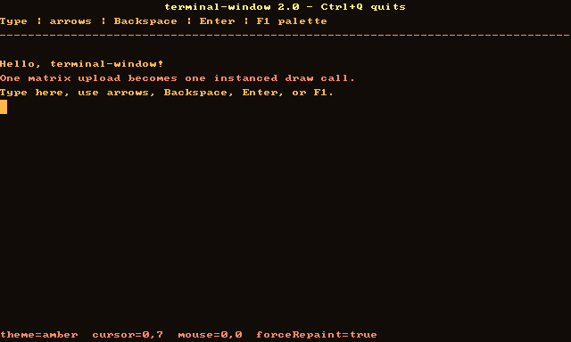

# terminal-window

A Kotlin/JVM terminal renderer: one `TerminalMatrix` becomes one instanced OpenGL draw.

[](https://github.com/psiwray-corp/terminal-window/actions/workflows/build.yml)
[](https://central.sonatype.com/artifact/com.psiwray.organization/terminal-window)
[](LICENSE)
[](docs/dependencies.md)
[](https://kotlinlang.org/)

- Coordinates: `com.psiwray.organization:terminal-window:2.0.0`; runtime:
  JDK 25, OpenGL 3.3 core, LWJGL 3.4.3, JOML 1.10.9.
- Build: Kotlin 2.4.21, Gradle 9.9.1, JVM target 25; license: MIT.

## v1 notice

v1 (`1.4.1`, 2021-10-24) shipped under GPL-3.0 on Java 11, LWJGL 3.2.0, and
JOML 1.10.2. It is abandoned; v2 is a Kotlin rewrite and replaces it. `1.4.1`
remains on Central because published versions are immutable. Both versions use
the package root `com.psiwray.organization.terminal_window`, so **do not put 1.x
and 2.x on one classpath or module path**. There is no bridge artifact.

## Requirements

- JDK 25 runtime, desktop OS with GLFW (Linux/X11, Windows, macOS), OpenGL **3.3 core** (4.1 core on macOS).
- Kotlin 2.4.21 and a `.twf` bitmap font; `examples/fonts/ascii-8x16.twf` is included. Java interop is best-effort.

## Install

The library publishes no native jars; add the host-specific LWJGL classifiers
yourself. A program that runs on several hosts needs each host's set.

```kotlin
val lwjglVersion = "3.4.3"
val lwjglNatives = "natives-linux" // choose the host classifier

dependencies {
    implementation("com.psiwray.organization:terminal-window:2.0.0")

    runtimeOnly("org.lwjgl:lwjgl:$lwjglVersion:$lwjglNatives")
    runtimeOnly("org.lwjgl:lwjgl-glfw:$lwjglVersion:$lwjglNatives")
    runtimeOnly("org.lwjgl:lwjgl-opengl:$lwjglVersion:$lwjglNatives")
    runtimeOnly("org.lwjgl:lwjgl-stb:$lwjglVersion:$lwjglNatives")
}
```

JOML, `lwjgl-stb`, and the Kotlin stdlib arrive transitively; do not declare them again. Do not use the LWJGL BOM.
Maven uses the same coordinate; copy the XML with the classifier table from [`docs/dependencies.md`](docs/dependencies.md).

On macOS add `-XstartOnFirstThread` to the JVM command line. On JDK 25 add
`--enable-native-access=ALL-UNNAMED` to avoid native-access warnings.

## Quickstart

Run from the repository root, or replace the font path in your own app. The
complete checked source is [`ReadmeQuickstart.kt`](examples/src/main/kotlin/com/psiwray/organization/terminal_window/examples/ReadmeQuickstart.kt).

```kotlin
package com.psiwray.organization.terminal_window.examples

import com.psiwray.organization.terminal_window.Colors
import com.psiwray.organization.terminal_window.TerminalWindowConfig
import com.psiwray.organization.terminal_window.TerminalWindowService
import com.psiwray.organization.terminal_window.font.BitmapFont
import com.psiwray.organization.terminal_window.input.InputListener
import com.psiwray.organization.terminal_window.input.Key
import com.psiwray.organization.terminal_window.input.KeyEvent
import java.nio.file.Path

public fun main() {
    TerminalWindowService.initialize().use { service ->
        service.openWindow(
            TerminalWindowConfig(font = BitmapFont.parse(Path.of("examples/fonts/ascii-8x16.twf"))),
        ).use { window ->
            window.matrix.write(0, 0, "Hello, terminal-window!", Colors.WHITE, Colors.BLACK)
            window.addInputListener(
                object : InputListener {
                    override fun onKey(event: KeyEvent) {
                        if (event.key == Key.Q) window.requestClose()
                    }
                },
            )
            while (!window.shouldClose) window.frame()
        }
    }
}
```

## Threading in three bullets

- `TerminalWindowService.initialize()`, `pump()`, window creation/destruction,
  and GLFW window-state changes run on the **process main thread** (the service thread).
- Each window has one **owner thread** with its GL context current. Transfer is
  explicit: `releaseContext()` on the old owner, then `acquireContext()` on the new
  one. The owner calls `frame()`; the service thread keeps pumping in multi-threaded mode.
- One rendered frame does at most **one matrix upload and one instanced draw**; a
  clean, unforced, unrequested frame performs no upload, draw, or swap. See
  [`docs/threading.md`](docs/threading.md) and [`docs/frame.md`](docs/frame.md).

## Font format

Fonts are UTF-8 `.twf` v1 text. A glyph is a fixed-size mask where `.` is
background and `#` is foreground:

```text
glyph U+0041
....##..
...####.
..#..#..
.#....#.
.######.
```

The normative grammar, limits, and line-numbered diagnostics are in
[`docs/font-format.md`](docs/font-format.md). TTF/OTF is not supported in 2.0.

## Examples
```sh
./gradlew :examples:hello
./gradlew :examples:twoThreads
./gradlew :examples:customFont --args="examples/fonts/ascii-8x16.twf"
./gradlew :examples:randomStress
```

`hello` is an interactive 80x24 editor with themes; `twoThreads` transfers two contexts to independent render threads;
`customFont` samples any `.twf`; `randomStress` rewrites all cells every frame. Screenshots are under `docs/assets`.



## Performance

Measured with llvmpipe on the host in [`docs/performance.md`](docs/performance.md); the benchmark is manual and CI only compiles it.

| Scenario | Grid | ns/frame | FPS | Alloc B/frame |
|---|---:|---:|---:|---:|
| `full-80x24` | 80x24 | 2,172,712 | 460.3 | 138.1 |
| `full-240x67` | 240x67 | 20,722,261 | 48.3 | 12.4 |
| `one-cell-240x67` | 240x67 | 20,802,594 | 48.1 | 0.0 |

Each scenario performs one upload and one draw per frame; the budget is 16 bytes
per cell and zero allocation per frame after warm-up. Run it with
`LIBGL_ALWAYS_SOFTWARE=1 ./gradlew :benchmarks:run`.

## Build and contribute
Requires JDK 25. Run `./gradlew build`; apply formatting with `./gradlew spotlessApply check`. Integration tests need
Xvfb and Mesa; see [`CONTRIBUTING.md`](CONTRIBUTING.md). Pull requests are welcome.

## License
MIT. v1 artifacts remain GPL-3.0; see [`docs/compatibility.md`](docs/compatibility.md) and [`LICENSE`](LICENSE).
