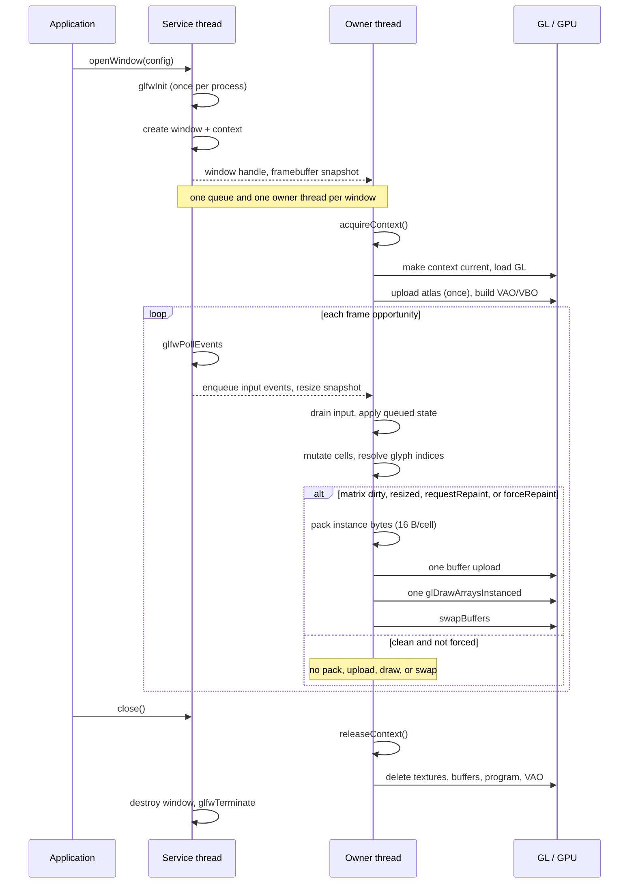

# Architecture

This document is the structural contract for `terminal-window` 2.0. It fixes
package placement, ownership, and the frame pipeline. It does not define
behaviour that belongs to a single section; each type's owning section is
listed in the object map.

- Decisions: `docs/adr/`.
- Public API and thread-affinity table: `docs/public-api.md`.
- Compatibility guarantees: `docs/compatibility.md`.
- Build guide: `GUIDE.md`.

## Package map

Root package: `com.psiwray.organization.terminal_window`.

| Package | Contents | Visibility |
|---|---|---|
| `com.psiwray.organization.terminal_window` | `TerminalWindow`, `TerminalWindowConfig`, `TerminalWindowService`, `GlfwOwnership`, `GlfwException`, `GlException`, `TerminalMatrix`, `ResizePolicy`, `RenderStats`, `ContextInfo`, `CursorShape`, `CursorMode`, `CursorImage`, `WindowIcon`, `Colors` | Public |
| `...terminal_window.font` | Immutable parsed font types, font-loading entry points, and internal atlas baking | Public package; atlas types internal |
| `...terminal_window.input` | Immutable input event types, enums, `Modifiers`, `CursorPosition`, `ClipboardListener` | Public |
| `...terminal_window.internal` | native GLFW backend, service-thread guard, window plumbing, input queue, frame scheduler, renderer, GL resources | Internal |

Rules:

1. `internal` never appears in a public signature.
2. Public signatures never expose LWJGL, GLFW, or OpenGL types. GL handles and
   driver data are converted to immutable values (`ContextInfo`, `RenderStats`)
   at the boundary.
3. `.font` and `.input` do not depend on `.internal`; they are pure Kotlin data
   and parsing. `TerminalWindow` is the only bridge between the public and
   internal worlds.
4. Only `.internal` may call LWJGL. This keeps the public classpath free of
   native-loading side effects until a window is opened.
5. No package cycles. `.internal` may depend on all other packages; the root may
   depend on `.font` and `.input`; those two depend only on the Kotlin stdlib.

## Object map

Names below are fixed for the sections that create them; a section may add
private types, but not move a type across the public/internal boundary.

| Type | Package | Owned by | Responsibility |
|---|---|---|---|
| `TerminalWindow` | root | 12, 13, 18, 25 | Public handle: open/close, cell writes, frame production, input listeners and direct-state queries, cursor/icon controls, `forceRepaint` (continuous) and `requestRepaint()` (one-shot) controls |
| `TerminalWindowConfig` | root | 12 | Immutable open-time configuration; no mutable bean |
| `Colors` | root | 10 | ARGB helpers and the default palette; stateless object |
| `Modifiers` | `.input` | 13 | `@JvmInline value class` over a bit mask |
| `RenderStats` | root | 14 | Immutable per-frame counters (cells, uploads, draws) |
| `ContextInfo` | root | 12 | Immutable driver/GL version strings and chosen context version |
| `CursorShape` | root | 25 | Standard cursor shape selection |
| `CursorMode` | root | 25 | Normal, hidden, or disabled cursor input mode |
| `CursorImage` | root | 25 | Immutable ARGB cursor image and validated hotspot |
| `WindowIcon` | root | 25 | Immutable ARGB window icon image |
| `BitmapFont` | `.font` | 08 | Immutable glyph source with code point lookup and fallback resolution |
| `BitmapFontParser` | `.font` | 08 | Internal strict `.twf` parser; reports `file:line:column` |
| `Atlas` | `.font` | 09 | Packed R8 mask bytes plus layout and slot metadata; internal |
| `AtlasBaker` | `.font` | 09 | Deterministic gutter-free grid search and mask baking; internal stateless object |
| `TerminalWindowService` | root | 11 | Process-global GLFW lifetime, service-thread guard, event pumping, queued state/destroy work, main-thread exit |
| `NativeGlfwBackend` | `.internal` | 11, 25 | Sole caller of LWJGL GLFW; checked error retrieval; cursor and icon native calls |
| `ServiceThread` | `.internal` | 11 | Main-thread and service-thread identity checks |
| `WindowRegistry` | `.internal` | 11, 12 | GLFW handle to owner thread, queue, and window state; callback routing |
| `WindowHandle` | `.internal` | 12, 17, 25 | Raw handle ownership, context-current transfer, pending framebuffer/content-scale application, cursor/icon state, close flag, and queued destruction |
| `CursorHandle` | `.internal` | 25 | Service-thread cursor creation, caching, and destruction |
| `ImageLoader` | `.internal` | 25 | stb_image decoding and ARGB conversion for icons and cursors |
| `InputQueue` | `.internal` | 13 | One per window; bounded discrete queue plus coalesced move, cursor-enter, and window-state slots; clipboard result queue; listener dispatch |
| `DeviceState` | `.internal` | 13 | Immutable service-thread key, mouse-button, and cursor snapshot for direct queries |
| `TerminalMatrix` | root | 10 | Flat cell arrays, mutation, dirty tracking |
| `ResizePolicy` | root | 10 | `PRESERVE_TOP_LEFT` or `CLEAR` resize behavior |
| `FrameScheduler` | `.internal` | 14 | Demand-driven frame cadence, dirty/resize/one-shot request checks, continuous forced repaint, and upload coalescing |
| `Renderer` | `.internal` | 16 | Instance packing, single upload, single draw, swap |
| `ShaderProgram` | `.internal` | 15 | Compilation, uniform location cache, failure diagnostics |
| `GlyphAtlas` | `.internal` | 15 | R8 atlas texture; upload, parameters, explicit `close()` |
| `GlResources` | `.internal` | 15 | Atlas texture, VAO, VBO; explicit `close()` |
| `InstanceFormat` | `.internal` | 15 | Byte offsets, sizes, and instanced attribute setup |
| `ResizeCalculator` | `.internal` | 17 | Framebuffer size to viewport/cell-grid transform; stateless object |
| `CellMetrics` | `.internal` | 17 | Pure cell-pixel size and derived grid dimensions |

GL handles are not `Closeable`; `TerminalWindow.close()` and `GlResources.close()`
release them explicitly.

## Thread map

| Thread | Calls | Never calls |
|---|---|---|
| Service thread | `glfwInit`, `glfwTerminate`, window create/destroy, `glfwPollEvents`, window registry, per-window queues, window state get/set, `glfwGetFramebufferSize`, `glfwGetKey`, `glfwGetMouseButton`, `glfwGetCursorPos`, `glfwGetClipboardString`, `glfwSetClipboardString`, callbacks (except error) | GL functions belonging to any window context |
| Owner thread (one per window) | `glfwMakeContextCurrent`, all GL commands, buffer upload, draw, `glfwSwapBuffers`, `glfwSwapInterval`, draining its own input queue, listener and clipboard-listener callbacks | Any GLFW window or event function; another window's queue |
| Application threads | Cell writes, `forceRepaint` / `requestRepaint()` controls, state setters, direct input-state reads, listener add/remove, clipboard writes and clipboard read requests | GLFW, GL, direct listener dispatch, or direct mutation of renderer state |

The service thread is the process main thread and the thread that calls
`glfwInit`. Context transfer between threads is explicit; see ADR-0004.

## Frame pipeline

Pipeline stages, in order:

1. **Poll.** The service thread polls GLFW once per frame opportunity for all
   windows and runs callbacks on itself.
2. **Handoff.** Each callback resolves its window through the registry and
   enqueues the event into that window's queue. The service thread publishes an
   immutable framebuffer snapshot into the same queue when it changed. No GL
   calls occur here.
3. **Drain.** Each owner thread drains only its own queue and applies queued
   window state at its frame boundary. Application cell writes are applied to
   that window's matrix here and mark it dirty; an applied resize does the same.
4. **Pack.** A dirty matrix, an applied resize, a queued
   `TerminalWindow.requestRepaint()`, or `TerminalWindow.forceRepaint` requires
   a rendered frame. A one-shot request forces exactly one frame and is cleared
   after that frame; multiple requests coalesce. The renderer walks the matrix
   and writes one 16-byte instance per cell into the preallocated direct buffer.
   Glyph indices are resolved to atlas slots; colors are already ARGB.
5. **Upload.** Exactly one upload per rendered frame. Dirty state only decides
   whether to render; it never creates a second GL call.
6. **Draw.** Exactly one instanced draw, four vertices per cell, derived from
   `gl_VertexID`.
7. **Swap.** `glfwSwapBuffers` on the owner thread after a rendered frame; vsync
   state comes from the swap interval. A clean, unforced, unrequested frame does
   not swap.

### Frame invariants

- Repaint is demand-driven. The matrix owns a dirty bit; cell mutations and
  resizes set it. `TerminalWindow.requestRepaint()` forces one frame with the
  current bounds and coalesces with other requests; `TerminalWindow.forceRepaint`
  overrides the dirty check and repaints every frame opportunity.
- A clean, unforced, unrequested frame performs no instance packing, buffer
  upload, draw, or swap, and allocates nothing on the heap.
- At most one instance upload and one draw call per window per rendered frame.
- Resizing marks the matrix dirty and may allocate a new instance buffer; the
  allocation happens at the resize, not per frame.
- The matrix is the single source of truth for cell content; the instance buffer
  is derived and may be rebuilt in full at any time.
- Cell coordinates are unsigned 16-bit; a grid larger than the instance format
  can address is rejected at resize.

### Build profile and platform selection

The build has two profiles, fixed at build time (ADR-0008):

- `debug` — `BuildInfo.DEBUG = true`, debug-only validation compiled in, LWJGL
  debug and checks enabled for the project's own run/test tasks, and on Linux
  `GLFW_PLATFORM_X11` set as an init hint before `glfwInit`.
- `release` — `BuildInfo.DEBUG = false`, debug branches constant-folded out,
  LWJGL checks disabled for the project's own run/test tasks, no platform hint,
  and the only profile that may be published.

The hint is process-global and is applied by `TerminalWindowService` on the
service thread before initialization; no other code touches it. A release build
lets GLFW choose the Linux backend, which may be Wayland.

JVM launcher flags are separate from the library: they are produced per OS by
`launchJvmArgs(profile, osName)` for project-owned run, test, and example
tasks, and are documented for consumers. macOS requires
`-XstartOnFirstThread`; the X11 backend choice is never expressed as a JVM flag
(ADR-0009).

### Resize and DPI path

The service thread reads `glfwGetFramebufferSize` (main-thread-only) per window,
compares it with that window's last published snapshot, and enqueues a new one.
That window's owner thread applies the snapshot at its frame boundary:
`ResizeCalculator` derives the viewport and cell grid, the matrix is reflowed,
and the instance buffer is reallocated if the cell count grew. GLFW is never
queried from the owner thread.

### Instance data

The per-cell layout is 16 bytes: column, row, glyph index, padding, RGBA8
foreground, RGBA8 background. The normative byte table and the no-blending rule
are in ADR-0005; `InstanceFormat` is the single place that encodes offsets in
code. The shader-facing attribute, varying, and uniform identifiers are
documented in [shaders.md](shaders.md).

## Error model

- Library code throws on misuse and on unrecoverable environment failures
  (no GLFW, no 3.3 context, malformed font, invalid configuration).
- No `System.exit`, no global exception handler, no swallowed errors.
- GLFW error text is retrieved with `glfwGetError` on the thread that made the
  call; the library installs no error callback.
- Font parse failures carry `file:line:column` and are reported before any GL
  resource is created.
- A failed context creation reports the requested versions, the platform, and
  the driver strings available without a context.

## Decision index

| Concern | ADR |
|---|---|
| Coordinates, version, package root | ADR-0001 |
| License | ADR-0002 |
| Kotlin/JDK/Gradle/JOML | ADR-0003 |
| GLFW threads, context ownership | ADR-0004 |
| Instanced draw, atlas, instance format | ADR-0005 |
| `.twf` font format | ADR-0006 |
| Automatic module name, JPMS | ADR-0007 |
| Debug/release profiles, Linux X11 hint | ADR-0008 |
| Platform JVM launch flags | ADR-0009 |

## Related

[Threading](threading.md) · [Frame contract](frame.md) ·
[Font format](font-format.md) · [Performance](performance.md) ·
[Public API](public-api.md)
