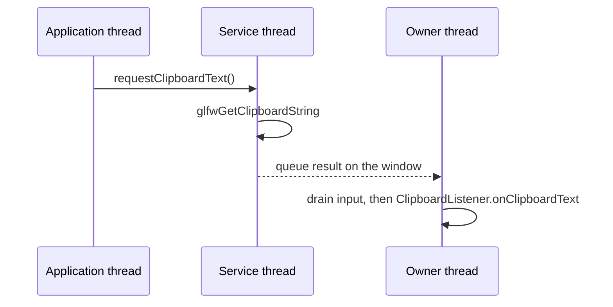

# Clipboard

`TerminalWindow` offers plain-text clipboard access through GLFW. No public API
exposes a GLFW handle or an `org.lwjgl.*` type, and the library adds no AWT or
platform UI dependency.

## API

| Call | Thread | Behavior |
|---|---|---|
| `setClipboardText(text)` | Any | Validates `text`, then writes it. Immediate on the service thread; queued from any other thread and applied before that thread's next poll. |
| `clipboardText()` | Service | Calls `glfwGetClipboardString` now and returns the text, or `null` when the clipboard holds no text. |
| `requestClipboardText()` | Any | Starts one read. Immediate on the service thread; queued otherwise. |
| `addClipboardListener` / `removeClipboardListener` | Any | Registers a `ClipboardListener`, whose single method `onClipboardText(text: String?)` runs on the window owner thread. |

`clipboardText()` is service-thread-only because GLFW clipboard reads are
main-thread-only; it never waits for the service loop. Every other call works
from any thread without blocking.

## Reading

Single-threaded applications run everything on the service thread, so a
request is not needed:

```kotlin
window.addInputListener(
    object : InputListener {
        override fun onKey(event: KeyEvent) {
            if (event.key == Key.V && event.modifiers.has(Modifiers.CONTROL)) {
                val matrix = window.matrix
                window.clipboardText()?.let { text ->
                    matrix.write(0, 0, text, matrix.defaultForeground, matrix.defaultBackground)
                }
            }
        }
    },
)
```

Multi-threaded applications read asynchronously. The read runs on the service
thread and the result is delivered on the window owner thread:

```kotlin
window.addClipboardListener { text -> if (text != null) insert(text) }
window.requestClipboardText()
```



Delivery rules:

- A result is delivered by the frame pipeline on the owner thread, after the
  input events drained in the same frame.
- Results are delivered in request order. Requests are never coalesced or
  dropped, and the result queue is not the bounded input-event queue: a full
  input queue does not lose clipboard results.
- The listener list is copy-on-write and is read at delivery time, like
  `InputListener`. Register the listener before requesting.
- No frame means no delivery. The result waits in the window's queue until the
  owner thread drains input.
- A clipboard that holds no text, or whose contents cannot be converted to
  UTF-8 text, is reported as `null`.
- Flushing is not implicit: requesting a read does not run the frame pipeline.

## Writing

`setClipboardText` copies the string into GLFW, which owns the platform
representation. On X11 the contents are served by the process for as long as it
runs; a clipboard manager, if present, keeps a copy after exit. A NUL character
is rejected with `IllegalArgumentException` because GLFW clipboard strings are
NUL-terminated C strings.

## Threads and errors

| Thread | Clipboard work |
|---|---|
| Service thread | `glfwSetClipboardString`, `glfwGetClipboardString`, NUL validation |
| Owner thread | `ClipboardListener` callbacks |
| Any thread | `setClipboardText`, `requestClipboardText`, listener add/remove |

Queued calls are applied by `TerminalWindowService.pump()` before polling.
Clipboard work is not part of the frame scheduler: writes and reads never mark
the matrix dirty or request a repaint.

`glfwGetClipboardString` reports `GLFW_FORMAT_UNAVAILABLE` for an empty or
unconvertible clipboard. The library treats that as a `null` result instead of
`GlfwException`; other GLFW errors surface from the next pump as usual.

## Platform notes

- **X11:** reads are a selection transfer and may block briefly while the
  selection owner responds. The process must keep processing events; the
  service thread does that when it pumps.
- **Wayland:** the compositor offers clipboard data to a focused window. A
  window that never had focus, or a hidden window, can legitimately report no
  text.
- **Windows and macOS:** reads use the platform pasteboard and return `null`
  when it holds no text.

## Limits

Plain text only. Rich text, images, files, the X11 primary selection, and
clipboard history are not part of this API.

## Related

[Input](input.md) · [Threading](threading.md) · [Public API](public-api.md)
