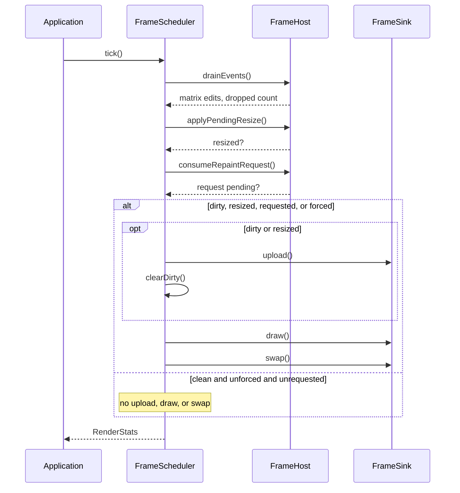

# Frame contract and update cadence

The frame scheduler is the only owner of frame ordering. Matrix edits and input
dispatch happen before any renderer call. A rendered tick performs one upload
(only when needed), one draw, and one swap. A clean, unforced, unrequested tick
does none of them.

## Tick ordering

`FrameScheduler.tick()` executes exactly:

1. `FrameHost.drainEvents()` — dispatch queued input and apply listener matrix
   edits.
2. `FrameHost.applyPendingResize()` — apply a framebuffer/content-scale resize,
   reflow the matrix, and reallocate the renderer storage. A resize marks the
   matrix dirty and returns `true`.
3. Consume the one-shot `requestRepaint()` flag and decide:
   `render = matrix.isDirty || resized || repaintRequested || forceRepaint`.
4. If `render` is false, return zero upload/draw/cell counters and call no sink
   method.
5. If the matrix is dirty or a resize was applied, call `upload()` once, then
   clear the matrix dirty flag.
6. Call `draw()` once.
7. Call `swap()` once. The one-shot request is already consumed and stays
   consumed only when the frame completes.

## GL call sequence

The scheduler calls the renderer only for a rendered tick. The renderer's
`upload()` and `draw()` are the only GL submission points.

`upload()`:

1. Bind the instance VBO to `GL_ARRAY_BUFFER`.
2. Upload the packed staging buffer once with
   `glBufferData(GL_ARRAY_BUFFER, staging, GL_STREAM_DRAW)`.
3. Unbind the buffer.

`draw()`:

1. `glViewport(0, 0, framebufferWidth, framebufferHeight)`.
2. Set `glClearColor` from `TerminalMatrix.defaultBackground`, then
   `glClear(GL_COLOR_BUFFER_BIT)`.
3. `glUseProgram`, set `uViewportPx`, `uCellPx`, `uAtlasCellPx`,
   `uAtlasGrid`, and `uAtlasTexels`.
4. Bind the R8 atlas on texture unit 0 and bind the instance VAO.
5. `glDrawArraysInstanced(GL_TRIANGLE_STRIP, 0, 4, columns * rows)`.
6. Unbind the VAO and program.

`swap()` then calls `glfwSwapBuffers` on the context-owning thread. A
zero-sized framebuffer is minimized: the scheduler skips upload, draw, and
swap, keeps the matrix dimensions, and reports zero counters. A repaint request
that arrives while minimized stays pending so the restored window can render
it.

## Render decision

| Matrix dirty | Resize applied | One-shot request | `forceRepaint` | Render | Upload |
|---|---|---|---|---|---|
| no | no | no | no | no | no |
| yes | either | either | either | yes | yes |
| no | yes | either | either | yes | yes |
| no | no | yes | either | yes | no |
| no | no | no | yes | yes | no |

`forceRepaint` is continuous: every tick renders, but a clean matrix still
uploads zero bytes and draws from the existing buffer. `requestRepaint()` is
one-shot: it renders exactly one tick and coalesces with other triggers.

## Failure behavior

- A listener or resize exception aborts the tick before any sink call. The
  matrix stays dirty and a pending one-shot request stays pending.
- A sink exception propagates. If a one-shot request was already consumed, the
  scheduler restores it so the next tick retries the rendered frame.
- Dirty state is cleared only after a successful `upload()`.

## Statistics

`RenderStats` describes one tick:

| Field | Meaning |
|---|---|
| `columns`, `rows` | Matrix dimensions after input and resize application. |
| `uploads` | `0` or `1`; whole-matrix uploads in this tick. |
| `uploadBytes` | `cellsDrawn * 16` when uploaded, otherwise `0`. |
| `drawCalls` | `0` or `1`. |
| `cellsDrawn` | `columns * rows` when uploaded, otherwise `0`. |
| `droppedEvents` | Cumulative discrete events dropped by the window. |

A skipped tick reports zero upload, byte, draw, and cell counters. A minimized
framebuffer is always a skipped tick, even when the matrix is dirty or a
repaint is pending; the pending state is retained for restoration. The
`droppedEvents` snapshot is cumulative window state, not a per-tick increment.

## Boundaries

`FrameSink` and `FrameHost` are internal. The scheduler imports no GL or GLFW
types; `Renderer` implements the sink in section 16. Section 14 tests use a
recording sink and fake host, so the ordering and counters are verified without
a display.

The test names in `FramePipelineTest` map directly to the acceptance cases:
dirty upload, 10,000 writes, clean tick, forced frames, one-shot frames, resize
upload, dispatch-before-sink ordering, listener failure, and sink failure.

## Related

[Threading](threading.md) · [Resize and DPI](resize.md) ·
[Performance](performance.md) · [Public API](public-api.md)