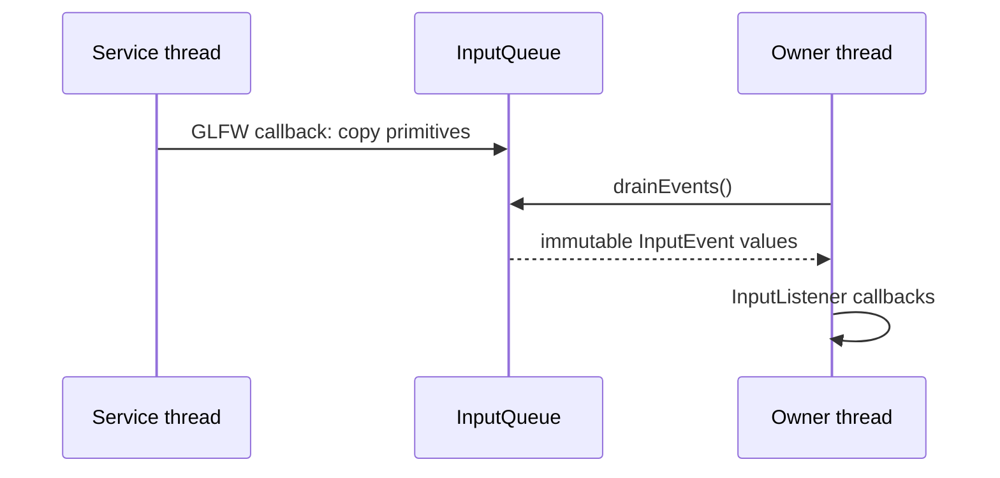

# Input

Input crosses two threads. GLFW callbacks run on the service thread; listener
code and direct-state reads run on the window owner thread or any application
thread. The library never exposes a GLFW handle or callback type.

## Event flow

Callbacks installed on window creation copy primitives into `InputQueue`; they
never call user code, GL, or GLFW window functions. The frame pipeline calls
`drainEvents()` on the owner thread. `addInputListener` and
`removeInputListener` use a copy-on-write list, so mutation during dispatch is
safe. A listener added during dispatch receives later events, not the event
currently being delivered.

## Event types

`InputEvent` is sealed. Every implementation is immutable.

| Event | Contents |
|---|---|
| `KeyEvent` | `Key`, platform scancode, `KeyAction`, `Modifiers`, repeat flag |
| `CharEvent` | one Unicode scalar value; no modifiers |
| `CursorEnterEvent` | cursor entered or left the content area |
| `MouseMoveEvent` | content-area pixel coordinates and cell coordinates |
| `MouseButtonEvent` | `MouseButton`, `KeyAction`, `Modifiers`, cell coordinates |
| `ScrollEvent` | horizontal and vertical scroll offsets |
| `ResizeEvent` | framebuffer width and height |
| `ContentScaleEvent` | horizontal and vertical content scale |
| `FocusEvent` | focused flag |
| `CloseRequestedEvent` | close request marker |

`KeyAction.REPEAT` is the GLFW repeat action. `KeyEvent.repeat` is true exactly
when the action is `REPEAT`. `CharEvent` has no modifier field because GLFW's
character callback does not provide modifiers.

## Queue and ordering

`InputQueue` has a fixed capacity of 1024 discrete events.

- `KeyEvent`, `CharEvent`, `MouseButtonEvent`, `ScrollEvent`, `ResizeEvent`,
  `ContentScaleEvent`, and `FocusEvent` are discrete events and use
  `ArrayBlockingQueue.offer`.
- `MouseMoveEvent` uses one latest-value slot. Only the newest move is
  delivered.
- `CursorEnterEvent`, `ResizeEvent`, `ContentScaleEvent`, `FocusEvent`, and
  `CloseRequestedEvent` also use latest-value slots. They are never dropped.
- If the discrete queue is full, the event is dropped and
  `TerminalWindow.droppedEvents` increments. The counter is monotonic.
- `drainEvents()` drains discrete events in arrival order, then delivers the
  latest move, enter/leave, resize, content-scale, focus, and close slots in
  that order. Slot events are state snapshots, not an event history.

A close request is therefore delivered even when the discrete queue is full.
Use the event stream for every key transition; direct state cannot reconstruct
presses that occurred between two polls.

## Clipboard

Clipboard text is not an `InputEvent`: the sealed hierarchy stays closed, so
adding clipboard state never breaks an exhaustive `when`. `requestClipboardText()`
triggers one service-thread read, and `ClipboardListener.onClipboardText`
receives the result on the owner thread after the input events of the same
drain, in request order. Single-threaded applications can instead read
synchronously with `TerminalWindow.clipboardText()` on the service thread. See
[Clipboard](clipboard.md).

## Close veto

The GLFW close callback sets the cached close flag and enqueues
`CloseRequestedEvent`. A listener may call `TerminalWindow.setCloseRequested(false)`
to veto the close. That call is queued to the service thread and clears the
GLFW close flag at the next pump. Without a veto, the application observes
`shouldClose` and closes the window through its normal lifecycle.

## Direct device state

After each service-thread poll, the service copies:
- `glfwGetKey` for every `Key`;
- `glfwGetMouseButton` for every `MouseButton`;
- `glfwGetCursorPos`.

The result is an immutable `DeviceState` snapshot. `TerminalWindow.isKeyPressed`,
`isMouseButtonPressed`, and `cursorPosition` read that snapshot from any thread.
They never call GLFW.

GLFW's key and mouse-button queries are themselves cached event state: they
report the last state delivered by `glfwPollEvents`, not an OS device poll. A
press and release between two polls is reported as released. `glfwGetCursorPos`
is a platform query in normal cursor mode and virtual state in disabled cursor
mode.

`CursorPosition.screenX` and `screenY` are GLFW screen coordinates relative to
the content area. `column` and `row` are derived from the cell size and integer
scale; either may be negative when the cursor is outside the content area. On
HiDPI displays, screen coordinates differ from framebuffer pixels by the
content scale, which `MouseMoveEvent.pixelX`/`pixelY` already apply.

## Keys and modifiers

`Key` is a hand-written enum covering GLFW 3.4 key tokens, including letters,
digits, function keys, navigation keys, keypad keys, and modifiers. Each enum
entry has exactly one `GLFW_KEY_*` code. `Key.UNKNOWN` maps to
`GLFW_KEY_UNKNOWN` and is never returned as pressed. `MouseButton` covers
buttons 1 through 8.

`Modifiers` is a value class over the GLFW modifier mask. Its public constants
are `NONE`, `SHIFT`, `CONTROL`, `ALT`, `SUPER`, `CAPS_LOCK`, and `NUM_LOCK`.
Unknown bits are masked at the GLFW boundary.

## GLFW callback coverage

`GlfwCallbacks` installs these GLFW 3.4 per-window callbacks:

| GLFW callback | Event |
|---|---|
| `glfwSetKeyCallback` | `KeyEvent` |
| `glfwSetCharCallback` | `CharEvent` |
| `glfwSetCursorPosCallback` | `MouseMoveEvent` |
| `glfwSetCursorEnterCallback` | `CursorEnterEvent` |
| `glfwSetMouseButtonCallback` | `MouseButtonEvent` |
| `glfwSetScrollCallback` | `ScrollEvent` |
| `glfwSetFramebufferSizeCallback` | `ResizeEvent` |
| `glfwSetWindowContentScaleCallback` | `ContentScaleEvent` |
| `glfwSetWindowFocusCallback` | `FocusEvent` |
| `glfwSetWindowCloseCallback` | `CloseRequestedEvent` |

Deliberately not installed:

| GLFW callback | Reason |
|---|---|
| `glfwSetWindowPosCallback`, `glfwSetWindowSizeCallback` | The library works in framebuffer/content coordinates; section 17 derives the render size from framebuffer size, not window geometry. |
| `glfwSetWindowRefreshCallback` | Rendering is demand-driven by the frame scheduler; there is no damaged-window redraw callback. |
| `glfwSetWindowIconifyCallback`, `glfwSetWindowMaximizeCallback` | No 2.0 API behavior depends on iconified/maximized state. |
| `glfwSetDropCallback` | File/path drop support is not part of the 2.0 API. |
| `glfwSetCharModsCallback` | Deprecated; text input uses `CharEvent`, and modifiers are intentionally absent. |
| `glfwSetErrorCallback` | Process-global; the service must not replace an application's callback. Errors are checked with `glfwGetError`. |
| `glfwSetMonitorCallback`, `glfwSetJoystickCallback` | Process-global device callbacks outside the terminal-window input model. |

## Thread rules

| Thread | Input work |
|---|---|
| Service thread | GLFW callbacks; callback registration; `glfwGetKey`, `glfwGetMouseButton`, `glfwGetCursorPos`; snapshot publication |
| Owner thread | `drainEvents`, listener callbacks, event-driven matrix changes |
| Any thread | `isKeyPressed`, `isMouseButtonPressed`, `cursorPosition`, `droppedEvents`, listener add/remove |

Callbacks never throw user exceptions. Listener exceptions propagate from
`drainEvents` to the frame pipeline.

## Related

[Threading](threading.md) · [Frame contract](frame.md) ·
[Public API](public-api.md) · [Clipboard](clipboard.md)
