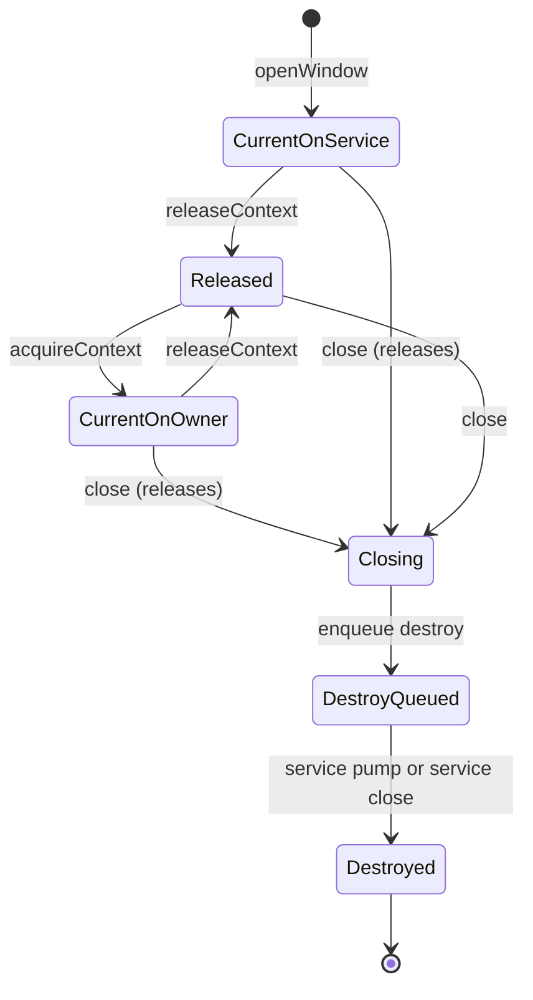

# Threading and the GLFW service

This document is the operational contract for `TerminalWindowService`. The
normative decision is ADR-0004; the GLFW quotes and the runtime behavior are
kept here for implementers.

## GLFW rules

| Rule | Consequence |
|---|---|
| `glfwInit`, `glfwTerminate`, window create/destroy, `glfwPollEvents`/`WaitEvents`, and nearly every window-state getter/setter are main-thread-only. | One service thread, the process main thread, owns all of them. |
| `glfwMakeContextCurrent`, `glfwGetCurrentContext`, `glfwSwapBuffers`, `glfwSwapInterval`, and `glfwExtensionSupported` may be called from any thread. | A window's context can be current on its owner thread. |
| A context is current on at most one thread at a time. | Release it before transferring it. |
| Event processing and window destruction are not reentrant. | Never call them from a GLFW callback. |

The "main thread" is the thread the JVM starts as `main`. The service also
rejects a second initialization from a different thread. The guard checks the
conventional `main` thread name because the JVM exposes no authoritative
main-thread ID; it is a misuse guard, not a security boundary.

## Service lifecycle

```kotlin
fun main() {
    TerminalWindowService.initialize().use { service ->
        service.openWindow(config)
        service.runEventLoop()
    }
}
```

- `initialize()` captures the caller as the service thread and increments the
  process-global reference count. Initialization fails on a non-main thread
  before any native call.
- `pump()` polls once and applies queued state/destroy work. `pump(timeout)`
  waits for events with a finite, non-negative timeout. Both must run on the
  service thread.
- `runEventLoop()` calls `pump()` until the last window opened through the
  service has been destroyed. It then returns, so `main` can return and the JVM
  can exit as it does after the last Swing window is disposed. It never calls
  `System.exit` and never stops another thread.
- `close()` releases one reference. At zero it terminates GLFW when the mode is
  `OWNED`, then unbinds the service thread. A second `close()` on the same
  instance is a no-op.
- `close()` drains queued destroy work but does not wait for owner-thread work.
  Owners must release contexts and finish their own cleanup before closing the
  service.

If no window is open when `runEventLoop()` is called, it returns immediately.
Start it after the first window exists. In single-threaded mode,
`TerminalWindow.frame()` pumps automatically and the application loop exits
when the window reports closed; `runEventLoop()` is for the multi-threaded
service-thread loop.

## Ownership modes

| Mode | `glfwInit` | `glfwTerminate` | Use |
|---|---|---|---|
| `OWNED` | Service calls it once per `initialize()` | Service calls it when the reference count reaches zero | Normal application |
| `EXTERNAL` | Caller already did it; service does not call it | Never | Host framework or embedding app owns GLFW |

Mixing modes while any service is active is an error. After the count reaches
zero and the service thread is unbound, a new initialization may choose the
other mode.

## Two usage modes

### Single-threaded

Everything runs on the service thread. `window.frame()` polls automatically;
the application does not run a separate event loop. State setters are applied
at the frame boundary.

### Multi-threaded

The service thread runs `service.runEventLoop()` (or a custom loop of
`pump()`/`pump(timeout)`). Each window has one owner thread. Owner threads call
`window.frame()`; that call does not poll GLFW. Window state setters enqueue to
the service thread.

The owner thread owns the window's context while it renders. Transfer is
explicit:

```kotlin
oldOwner.releaseContext()   // glfwMakeContextCurrent(NULL)
newOwner.acquireContext()   // glfwMakeContextCurrent(window)
```

Both calls check that the caller is the expected owner and that the context is
in the expected state. Never make a context current on two threads.

## Window lifecycle

`TerminalWindowService.openWindow(config)` creates the window and context on
the service thread. The context starts current there, so the service thread is
the initial owner. In multi-threaded mode, transfer it explicitly before the
render thread begins work.



Rules:

- `acquireContext()` requires a released context and makes the calling thread
  the owner. `releaseContext()` requires the calling thread to be the owner.
- `close()` is idempotent. It releases the context if the caller owns it, marks
  the window closed, and queues native destruction. If another thread owns the
  context, `close()` throws; release it on the owner first.
- The service thread performs `glfwDestroyWindow` during `pump()` or
  `TerminalWindowService.close()`. Window-state calls are skipped once the
  window is closed.
- `awaitClosed()` blocks until native destruction completes, except on the
  service thread, where it returns immediately to avoid deadlock.
- `isClosed` becomes true when `close()` starts; `awaitClosed()` is the signal
  that native destruction finished.
- `runEventLoop()` returns after the registry becomes empty. The registry, not
  a separate counter, is the source of truth for open windows.

## Queues and shutdown

The service has two service-thread-drained queues. They carry opaque
service-thread operations; section 12 supplies the window-specific operations.

| | `stateOps` | `destroyOps` |
|---|---|---|
| Purpose | Normal, non-terminal window state: title, cursor, icon, size, visibility, should-close, queued clipboard writes and reads | Window destruction and its context/registry cleanup |
| Producers | Any thread, through the service | Any thread, through the service |
| Consumer | Service thread in `pump()` | Service thread in `pump()` and `close()` |
| Drain point | Before `destroyOps`, before the GLFW poll | After `stateOps`, before the GLFW poll; also during `close()` |
| Failure behavior | Drain stops at the throwing operation; the rest wait for a later pump | Drain continues; the first exception is rethrown after all requests run |
| Shutdown behavior | Not drained by `close()`; pending state work is the caller's responsibility | Drained by `close()` before the reference count is released |
| Backpressure | Unbounded; low-frequency | Unbounded; low-frequency |

### `stateOps`

- FIFO within the queue. Every accepted operation runs; operations are not
  coalesced, even when a later operation overwrites the same window state.
- An operation may enqueue more state work, which is handled by the same drain
  loop before polling.
- If an operation throws, that operation and everything before it have run;
  the remaining state operations and the destroy queue wait for the next pump.
- New state operations are rejected after `close()` begins.
- A state operation may enqueue a destroy operation; because `pump()` drains
  `stateOps` to exhaustion first, the new destroy request is picked up by the
  same pump.

### `destroyOps`

- FIFO within the queue. A destroy request is never dropped.
- `pump()` drains it after `stateOps` and before polling, so queued state changes
  are applied before a window disappears.
- `close()` drains it even though `close()` intentionally skips `stateOps`.
  This is what guarantees that a final window destruction is not lost during
  shutdown.
- Exceptions do not stop the drain. After every queued destroy has run, the
  first exception is rethrown. `close()` still releases its reference and
  terminates owned GLFW before rethrowing.
- During `pump()`, an operation may enqueue more destroy work; the same drain
  loop handles it. During `close()`, `closed` is already set, so a nested
  destroy enqueue throws and is reported as a drain failure instead of being
  silently dropped.
- A destroy operation that enqueues state work during `pump()` leaves that
  work for the next pump; during `close()` the enqueue is rejected because
  `close()` does not drain `stateOps`.

### Common rules

- Both queues are `ConcurrentLinkedQueue`; producers never block on a consumer.
- Queue acceptance is synchronized with the `closed` transition under
  `queueLock`. This prevents the race where an enqueue observes “open” just as
  `close()` drains the queue and would otherwise lose the request.
- Neither queue is bounded and neither applies backpressure. They are for
  low-frequency control work, never per-cell or per-frame operations.
- A pending owner-thread frame is not a service-thread responsibility. Owners
  must release contexts and finish their own cleanup before `close()`.
- Neither queue replaces the window registry. The registry owns window identity,
  owner-thread association, and per-window state; the queues only carry work.

## Input and direct state

GLFW input callbacks run on the service thread. They only copy primitives into
the per-window `InputQueue`; they never call user listeners, GL, or window-state
functions.

- Listener dispatch happens in `drainEvents()` on the context owner thread.
  The frame pipeline calls that hook; an owner or application thread must not
  call GLFW to obtain events.
- `glfwGetKey`, `glfwGetMouseButton`, and `glfwGetCursorPos` run on the service
  thread after each poll. Their results become an immutable `DeviceState`
  snapshot.
- `TerminalWindow.isKeyPressed`, `isMouseButtonPressed`, and `cursorPosition`
  read that snapshot from any thread. They never call GLFW.
- Cursor shape/image replacement, cursor visibility/mode, and window icons are
  queued state operations. Standard cursor creation and caching, custom cursor
  creation/destruction, and `glfwSetWindowIcon` happen only on the service
  thread.
- GLFW key and mouse-button queries are cached event state, not OS device
  polling. A press and release between two polls is reported as released.
  Use the event stream for edges.
- `glfwGetCursorPos` is a platform query in normal cursor mode and virtual
  state in disabled cursor mode.
- The discrete input queue is bounded at 1024 events. Overflow drops the event
  and increments `TerminalWindow.droppedEvents`; cursor movement and the latest
  window-state events are coalesced and are never dropped.
- `glfwGetClipboardString` and `glfwSetClipboardString` are main-thread-only.
  `TerminalWindow.clipboardText()` calls the getter directly and therefore
  requires the service thread; `setClipboardText` and `requestClipboardText`
  run immediately on the service thread and are queued state operations
  elsewhere. Completed reads are delivered to `ClipboardListener`s on the owner
  thread after input events. Clipboard results use their own unbounded,
  request-driven queue and are never coalesced.

## Error channel

Checks copy GLFW's code and description immediately with `glfwGetError`. The
service does not install a process-wide GLFW error callback; that would replace
the application's callback and is rejected by ADR-0004. The copied values become
a `GlfwException` on the checked service-thread operation. GLFW's original
description pointer is never retained.

## Do / don't

| Do | Don't |
|---|---|
| Call `initialize`, `pump`, `runEventLoop`, and `close` on the process main thread. | Call `glfwInit`, `glfwPollEvents`, or window functions from an owner or worker thread. |
| Release a context before acquiring it on another thread. | Leave the same context current on two threads. |
| Queue window state changes to the service thread. | Call a main-thread-only window setter directly from an owner thread. |
| Create and destroy windows on the service thread. | Destroy a window from an event callback. |
| Return from the service loop after the last window closes. | Call `System.exit` or stop the main thread from library code. |
| Close the service after all owner work is drained. | Assume pending owner frames are completed by `close()`. |
| Keep LWJGL/GLFW handles out of public API. | Expose `Long` handles or GLFW types to callers. |

## Related

[Architecture](architecture.md) · [Frame contract](frame.md) ·
[Public API](public-api.md) · [Input](input.md) · [Clipboard](clipboard.md) ·
[Cursor customization](cursor.md)
